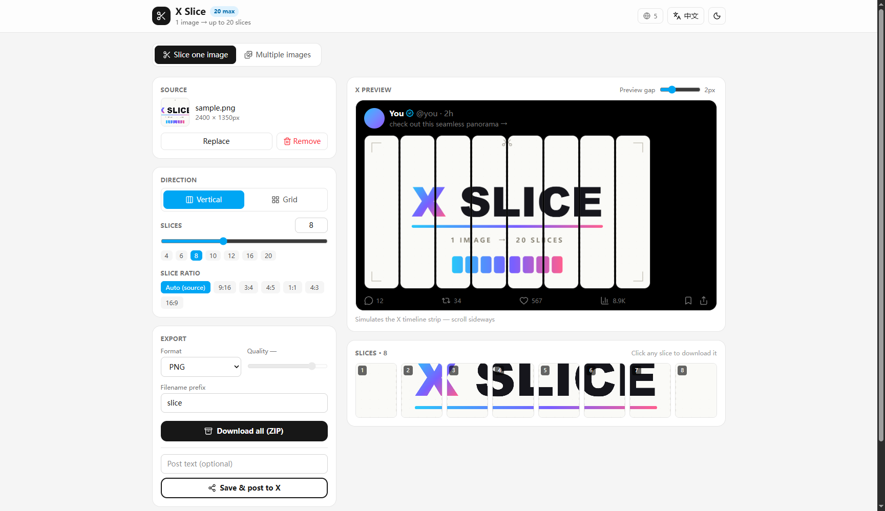
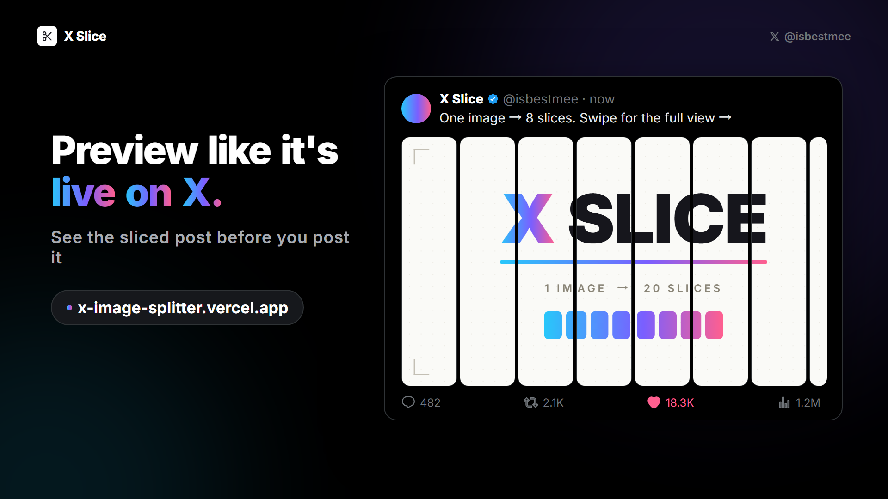
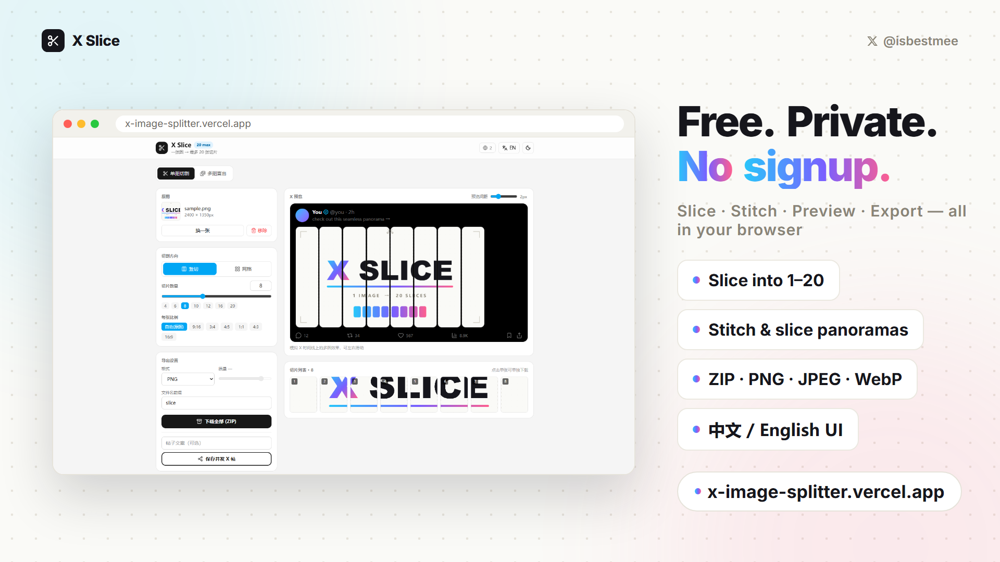

<div align="center">


# X Slice

**Turn 1 image into up to 20 seamless slices for X multi-image posts.**
**一张图切成最多 20 张无缝切片，轻松制作 X 多图帖子。**

[](https://x-image-splitter.vercel.app)
[](LICENSE)


</div>

X now allows **20 images per post** — which turned "seamless panorama posts" into a real creative format. X Slice is the easiest way to make them: drop an image, slice it vertically or into a grid, preview it exactly like the X timeline, export a ZIP, post.

X 单条帖子现在最多能发 **20 张图**，「无缝全景多图帖」成了真正好用的玩法。X Slice 让制作变得极简：拖入图片 → 竖切或网格切割 → X 时间线实时预览 → 导出 ZIP → 发帖。

## 🎬 Demo · 演示


▶️ **[Watch the full 30s promo](docs/media/x-slice-promo.mp4)** (soundtrack synthesized from scratch) · 观看 30 秒完整宣传片（配乐为纯代码合成）

## ✨ Features · 功能

- 🔪 **Slice up to 20** — vertical strips or a rows×cols grid, total capped at 20 · **竖切 / 网格切割，最多 20 张**
- 🧩 **Stitch & slice** — join multiple images into one panorama, then slice it · **多图横向拼接成全景再切割**
- 👀 **Live X preview** — pixel-faithful timeline strip with adjustable gap · **X 时间线实时预览**，间距可调
- 📐 **Slice aspect ratio** — auto / 9:16 / 3:4 / 4:5 / 1:1 / 4:3 / 16:9 · **自定义切片比例**，居中裁剪
- 💾 **Export** — PNG / JPEG / WebP, quality control, filename prefix, ZIP or single slices · **多格式导出、质量调节、ZIP 打包**
- 🐦 **Save & post to X** — Web Share on mobile, save-to-folder + composer on desktop · **一键保存并发 X 帖**
- 🌐 **EN / 中文 UI** — language picker on first visit, remembers your choice · **中英双语界面**，自动记住选择
- 🌙 **Dark mode & responsive** · **深色模式**，移动端适配
- 🔒 **100% local** — images never leave your device · **纯本地处理，图片不上传**

## 📸 Screenshots · 界面截图

<p align="center">
  
  
</p>

<p align="center">
  
  
</p>

## 🚀 Quick start · 快速开始

```bash
npm install
npm run dev      # http://localhost:5173
npm run build    # → dist/
```

### Deploy · 部署

The app is fully static — `dist/` can be hosted anywhere.
本站为纯静态应用，`dist/` 可部署到任意静态托管。

For Vercel, we ship a Build Output API script (also works around Windows symlink-permission issues · 可绕过 Windows 符号链接权限问题):

```bash
npm run build && node scripts/prepare-output.mjs && npx vercel deploy --prebuilt --prod
```

Or just connect this repo in the Vercel dashboard for automatic cloud builds · 也可在 Vercel 后台绑定本仓库，push 即自动部署。

## 🛠 Tech stack · 技术栈

Vite · React 19 · TypeScript · Tailwind CSS v4 · JSZip · Lucide — every pixel is processed on Canvas 2D in the browser · 所有图像处理均在浏览器 Canvas 中完成。

## 🔒 Privacy & Security · 隐私与安全

- **No backend** — every byte stays in your browser · 无后端，所有数据留在本地
- Strict `Content-Security-Policy` + security headers (`vercel.json`, `scripts/prepare-output.mjs`) · 严格 CSP 与安全响应头
- Input guards: ≤150 MB/file, ≤16384 px/side, ≤100 MP total · 输入校验防超大文件与像素炸弹
- `.npmrc` → `ignore-scripts=true` for supply-chain safety · 阻断依赖生命周期脚本，防供应链攻击
- No `eval`, no `innerHTML`, no remote scripts, no secrets · 无危险 API、无远程脚本、无密钥

## 🎥 Promo project · 宣传片工程

`promo/` is the complete Remotion project behind the video & posters — including `promo/scripts/music.mjs`, which synthesizes the entire soundtrack in pure Node (no samples, no deps).

`promo/` 目录是宣传片与海报的完整 Remotion 工程，`promo/scripts/music.mjs` 用纯 Node 从零合成了整段配乐。

```bash
cd promo && npm install
npm run music     # synthesize soundtrack → public/music.wav
npm run render    # render the 30s video → out/x-slice-promo.mp4
npm run posters   # render promo posters (EN+ZH) → out/posters/
```

## 📜 License

MIT — do whatever you want, attribution appreciated. · MIT 开源，欢迎随意使用，保留署名更佳。

## 👤 Author · 作者

Made by **[@isbestmee](https://x.com/isbestmee)** — follow on X for updates. · 在 X 上关注获取更新。
